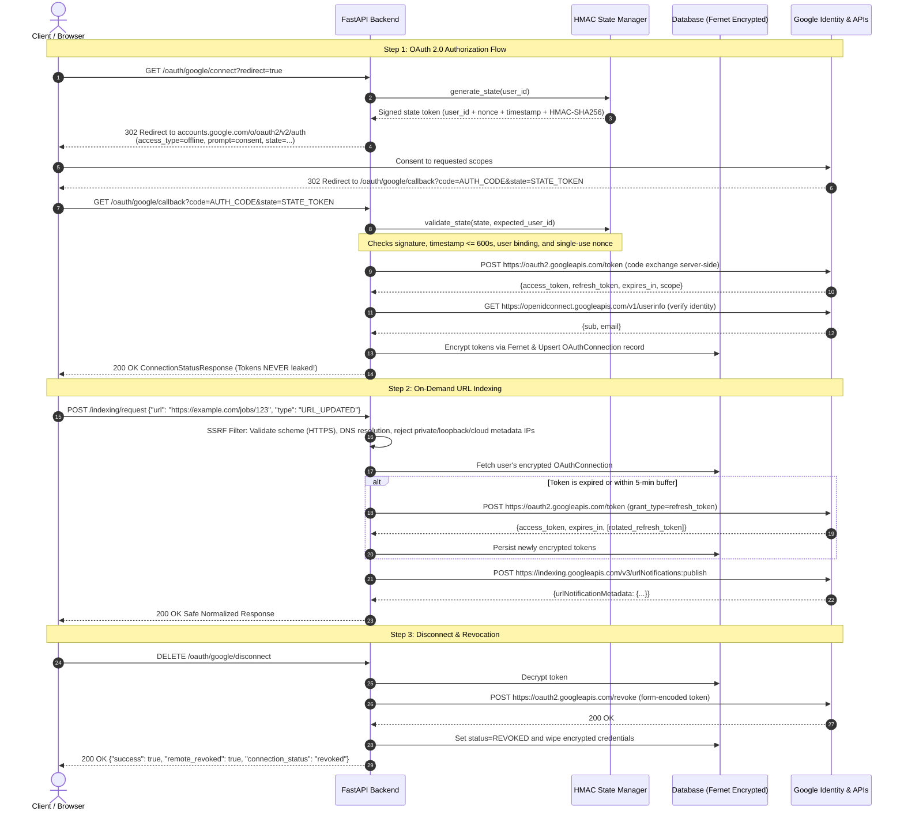

# OAuth Whiteboard — Google Search Console & Indexing API Integration

A production-grade, secure, and fully-tested FastAPI backend demonstrating the complete **Google OAuth 2.0 flow**, authenticated **token encryption at rest**, **automatic pre-emptive token refresh with concurrency locking**, **graceful revocation**, and an **on-demand URL indexing notification workflow** integrated with Google's Indexing API and Search Console.

---

## Table of Contents
1. [Problem Statement & Scope](#problem-statement--scope)
2. [Architecture & OAuth Sequence Diagram](#architecture--oauth-sequence-diagram)
3. [Technology Stack & Rationale](#technology-stack--rationale)
4. [Google Cloud Console Setup & Redirect URI](#google-cloud-console-setup--redirect-uri)
5. [OAuth Scopes & Least Privilege](#oauth-scopes--least-privilege)
6. [Environment Variables & Secret Configuration](#environment-variables--secret-configuration)
7. [Database Architecture & Migrations](#database-architecture--migrations)
8. [Local Installation & Quickstart](#local-installation--quickstart)
9. [API Endpoint Documentation & Examples](#api-endpoint-documentation--examples)
10. [Token Lifecycle & Encryption Strategy](#token-lifecycle--encryption-strategy)
11. [Refresh, Revocation & Disconnect Mechanics](#refresh-revocation--disconnect-mechanics)
12. [Google Password Changes & Credential Invalidation](#google-password-changes--credential-invalidation)
13. [Indexing API vs. Search Console Restrictions](#indexing-api-vs-search-console-restrictions)
14. [Running Automated Tests](#running-automated-tests)
15. [Production Security Hardening](#production-security-hardening)
16. [Known Limitations & Future Improvements](#known-limitations--future-improvements)

---

## Problem Statement & Scope

Modern web applications frequently require authenticated integration with Google APIs (such as Google Search Console and the Google Indexing API) to monitor indexing status and trigger automated crawl notifications.

Implementing this requires solving critical engineering and security challenges:
- **CSRF, Authorization-Code Replay, and Account Mix-Up Prevention:** Preventing attackers from binding their Google identity or malicious tokens to victim accounts.
- **Token Security at Rest:** Protecting high-privilege offline refresh tokens against database breaches using authenticated symmetric encryption with key rotation capabilities.
- **Seamless Token Refresh:** Ensuring API consumers never experience downtime due to expired access tokens, while preventing race conditions or stampedes on token refresh.
- **Strict SSRF Mitigation:** Protecting internal infrastructure and cloud metadata services when accepting URLs for indexing notifications.
- **Accurate Domain Grounding:** Distinguishing between Google's real-time Indexing API (officially reserved for `JobPosting` and `BroadcastEvent` structured data) and Google Search Console property inspection.

---

## Architecture & OAuth Sequence Diagram

The following Mermaid sequence diagram illustrates the lifecycle of authentication, state validation, encrypted persistence, automatic refresh, and indexing invocation.



---

## Technology Stack & Rationale

| Component | Technology | Rationale |
| :--- | :--- | :--- |
| **Runtime** | Python 3.11+ | Enhanced async performance, exception groups, and type hinting. |
| **Framework** | FastAPI & Uvicorn | Async ASGI framework with automatic OpenAPI documentation and high-throughput async I/O. |
| **Validation** | Pydantic v2 & Pydantic Settings | Strictly typed data modeling, fast Rust-based validation core, and secure environment configuration with secret masking. |
| **Database** | SQLAlchemy 2.0 (Async) | Modern async ORM supporting PostgreSQL (`asyncpg`) for production and SQLite (`aiosqlite`) for zero-friction local development. |
| **HTTP Client** | HTTPX (Async) | Full async HTTP/1.1 and HTTP/2 client for non-blocking outbound requests to Google endpoints. |
| **Cryptography** | Fernet (`cryptography`) | Authenticated symmetric encryption (AES-128-CBC with HMAC-SHA256) ensuring integrity and confidentiality of stored tokens; includes `MultiFernet` key rotation. |
| **State Security** | HMAC-SHA256 + Time/Nonce | Cryptographically signed, short-lived (10 min), user-bound state values with anti-replay tracking. |
| **Testing** | Pytest, Pytest-Asyncio, Respx | Async test suite with mock Google HTTP endpoints preventing external network dependencies. |

---

## Google Cloud Console Setup & Redirect URI

To run this application against real Google Cloud credentials:

1. **Create / Select a GCP Project:**
   - Navigate to the [Google Cloud Console](https://console.cloud.google.com/).
   - Create a project (e.g. `oauth-whiteboard-prod`).

2. **Enable Required APIs:**
   - Under **APIs & Services > Library**, enable:
     - **Google Search Console API** (`webmasters.googleapis.com`)
     - **Web Search Indexing API** (`indexing.googleapis.com`)

3. **Configure the OAuth Consent Screen:**
   - Navigate to **APIs & Services > OAuth consent screen**.
   - User Type: Select **External** (or **Internal** for Google Workspace orgs).
   - Fill in App Name, User support email, and Developer contact information.
   - Add scopes: `openid`, `.../auth/userinfo.email`, `.../auth/userinfo.profile`, `.../auth/indexing`, and `.../auth/webmasters.readonly`.
   - Add your Google account under **Test Users** if the app status is "Testing".

4. **Create OAuth 2.0 Web Client Credentials:**
   - Navigate to **APIs & Services > Credentials > Create Credentials > OAuth client ID**.
   - Application type: **Web application**.
   - Name: `OAuth Whiteboard API`.
   - **Authorized redirect URIs** (Exact Match Required):
     - For local development: `http://localhost:8000/oauth/google/callback`
     - For production: `https://yourdomain.com/oauth/google/callback` *(Google strictly rejects non-HTTPS redirect URIs in production except for localhost)*.
   - Save your **Client ID** and **Client Secret**.

---

## OAuth Scopes & Least Privilege

The application enforces the principle of least privilege:

| Scope | Purpose |
| :--- | :--- |
| `openid` | Verifies user identity via OpenID Connect standard. |
| `https://www.googleapis.com/auth/userinfo.email` | Retrieves the primary email of the connected Google account for user display. |
| `https://www.googleapis.com/auth/userinfo.profile` | Obtains basic profile identifier (`sub`). |
| `https://www.googleapis.com/auth/indexing` | Authorizes submitting `URL_UPDATED` and `URL_DELETED` notifications to Google's Indexing API. |
| `https://www.googleapis.com/auth/webmasters.readonly` | Read-only access to verify Search Console site properties and ownership. |

---

## Environment Variables & Secret Configuration

Copy `.env.example` to `.env`:

```bash
cp .env.example .env
```

### Configuration Variables

| Variable | Description | Default / Example |
| :--- | :--- | :--- |
| `ENVIRONMENT` | `development`, `staging`, or `production` | `development` |
| `LOG_LEVEL` | Logging verbosity (`DEBUG`, `INFO`, `WARNING`, `ERROR`) | `INFO` |
| `DATABASE_URL` | Async SQLAlchemy URL | `sqlite+aiosqlite:///./oauth_whiteboard.db` |
| `SECRET_KEY` | HMAC key for state signature (>= 32 chars) | `UwUS_7PmdAz...` |
| `ENCRYPTION_KEY` | Primary Fernet key for token encryption | Base64-encoded 32 bytes |
| `ROTATION_ENCRYPTION_KEYS` | Optional comma-separated list of previous Fernet keys | `key1,key2` |
| `GOOGLE_CLIENT_ID` | OAuth Client ID from Google Cloud Console | `*.apps.googleusercontent.com` |
| `GOOGLE_CLIENT_SECRET` | OAuth Client Secret from Google Cloud Console | `GOCSPX-...` |
| `GOOGLE_REDIRECT_URI` | Exact OAuth redirect URI registered in Google Console | `http://localhost:8000/oauth/google/callback` |
| `DEFAULT_USER_ID` | Fallback user ID for local browser testing | `user_dev_01` |

> [!NOTE]
> Generate a cryptographically strong Fernet key using:
> ```bash
> python -c "from cryptography.fernet import Fernet; print(Fernet.generate_key().decode())"
> ```

---

## Database Architecture & Migrations

The database layer uses **SQLAlchemy 2.0 Async** and dynamically switches between PostgreSQL and SQLite.

### Schema: `oauth_connections`

| Column | Type | Description |
| :--- | :--- | :--- |
| `id` | Integer (PK) | Auto-increment primary key |
| `user_id` | String(128) | Indexed application user ID |
| `provider` | String(32) | OAuth provider (`google`) |
| `google_sub` | String(128) | Google account subject ID (verified via OIDC) |
| `google_email` | String(256) | Connected Google account email address |
| `encrypted_access_token` | Text | Fernet AES-128-CBC + HMAC encrypted access token |
| `encrypted_refresh_token` | Text (Nullable) | Fernet encrypted refresh token (offline access) |
| `access_token_expires_at` | DateTime (UTC) | Token expiry timestamp |
| `granted_scopes` | Text | Space-delimited string of approved scopes |
| `connection_status` | String(32) | Status: `active`, `revoked`, `expired`, `reauth_required` |
| `created_at` | DateTime (UTC) | Record creation timestamp |
| `updated_at` | DateTime (UTC) | Record modification timestamp |

**Constraints:**
- `UniqueConstraint("user_id", "provider", name="uq_user_provider")`: Guarantees one connection per user/provider, preventing race-condition duplicate connections.

---

## Local Installation & Quickstart

### Prerequisites
- Python 3.11+
- Git

### 1. Clone & Set Up Virtual Environment

```bash
cd "OAuth WhiteBoard"
python3.11 -m venv .venv
source .venv/bin/activate
pip install -r requirements.txt
```

### 2. Configure Environment

```bash
cp .env.example .env
# Edit .env and supply your Google credentials or use development defaults
```

### 3. Run Application Server

```bash
uvicorn app.main:app --host 127.0.0.1 --port 8000 --reload
```

Interactive OpenAPI documentation is available at: [http://127.0.0.1:8000/docs](http://127.0.0.1:8000/docs).

### 4. Running with Docker Compose (PostgreSQL)

```bash
docker compose up --build
```

---

## API Endpoint Documentation & Examples

### 1. Health & Readiness
- `GET /health`: Liveness probe (`200 OK`).
- `GET /ready`: Readiness probe validating database connectivity (`200 OK`).

```bash
curl -i http://localhost:8000/health
```

### 2. OAuth Initiation: `GET /oauth/google/connect`
Initiates Google OAuth 2.0 authorization.
- Query Parameter: `redirect=true` (default: 302 redirect) or `redirect=false` (returns JSON).
- Header: `X-User-ID: user_alice` (optional in dev, mandatory in production).

```bash
curl -s "http://localhost:8000/oauth/google/connect?redirect=false" \
  -H "X-User-ID: user_alice"
```
**Response:**
```json
{
  "authorization_url": "https://accounts.google.com/o/oauth2/v2/auth?client_id=...&redirect_uri=...&response_type=code&scope=...&access_type=offline&prompt=consent&state=...",
  "state": "eyJ1c2VyX2lkIjoidXNlcl9hbGljZSIs..."
}
```

### 3. OAuth Callback: `GET /oauth/google/callback`
Invoked automatically by Google following user consent. Exchanges authorization code server-side and stores encrypted credentials.

```bash
curl -s "http://localhost:8000/oauth/google/callback?code=AUTH_CODE&state=STATE_STRING" \
  -H "X-User-ID: user_alice"
```

### 4. Connection Status: `GET /oauth/google/status`
Returns metadata regarding the connected account. **Never leaks access or refresh tokens.**

```bash
curl -s http://localhost:8000/oauth/google/status \
  -H "X-User-ID: user_alice"
```
**Response:**
```json
{
  "connected": true,
  "connection_status": "active",
  "provider": "google",
  "google_email": "alice@company.com",
  "google_sub": "104928392019283",
  "granted_scopes": [
    "openid",
    "https://www.googleapis.com/auth/userinfo.email",
    "https://www.googleapis.com/auth/indexing"
  ],
  "access_token_expires_at": "2026-10-15T11:00:00Z",
  "expires_in_seconds": 3540,
  "has_refresh_token": true
}
```

### 5. On-Demand URL Indexing: `POST /indexing/request`
Submits crawl notifications (`URL_UPDATED` or `URL_DELETED`) to Google's Indexing API. Pre-emptively refreshes expired tokens and filters for SSRF.

```bash
curl -s -X POST http://localhost:8000/indexing/request \
  -H "Content-Type: application/json" \
  -H "X-User-ID: user_alice" \
  -d '{
    "url": "https://example.com/jobs/senior-backend-engineer",
    "type": "URL_UPDATED"
  }'
```
**Response:**
```json
{
  "url": "https://example.com/jobs/senior-backend-engineer",
  "type": "URL_UPDATED",
  "notify_time": "2026-10-15T09:30:15Z",
  "status": "SUBMITTED",
  "message": "Indexing notification successfully accepted by Google Indexing API. Note: Submission does not guarantee that Google will index the URL or rank it."
}
```

### 6. Disconnect & Revocation: `DELETE /oauth/google/disconnect`
Revokes credentials at Google's official revocation endpoint and immediately wipes local credentials.

```bash
curl -s -X DELETE http://localhost:8000/oauth/google/disconnect \
  -H "X-User-ID: user_alice"
```
**Response:**
```json
{
  "success": true,
  "message": "Google account disconnected successfully.",
  "remote_revoked": true,
  "connection_status": "revoked"
}
```

### 7. Google Search Console Properties: `GET /search-console/sites`
Lists verified Search Console web properties accessible to the authenticated user.

```bash
curl -s http://localhost:8000/search-console/sites \
  -H "X-User-ID: user_alice"
```

---

## Token Lifecycle & Encryption Strategy

### 1. Authenticated Encryption at Rest (Fernet)
- Tokens are never stored in plaintext. They are encrypted using `cryptography.fernet.Fernet`, implementing **AES-128-CBC** encryption with PKCS7 padding and **HMAC-SHA256** authentication.
- Any attempt to modify ciphertext in the database results in authentication failure during decryption.

### 2. Zero-Downtime Key Rotation (`MultiFernet`)
- The application supports multiple encryption keys:
  - `ENCRYPTION_KEY`: Primary key used for all new encryptions.
  - `ROTATION_ENCRYPTION_KEYS`: Comma-separated list of previous keys.
- When reading tokens, `TokenEncryptor` attempts decryption with the primary key, followed by fallback rotation keys.
- Ciphertexts can be incrementally migrated to the latest key using `encryptor.rotate_ciphertext(old_cipher)`.

### 3. Existing Refresh Token Preservation
- Google only returns a `refresh_token` upon initial consent or when `prompt=consent` is explicitly supplied.
- If a user completes subsequent authorization flows and Google returns a fresh `access_token` without a `refresh_token`, `TokenService.save_connection` **preserves the existing valid refresh token**.

---

## Refresh, Revocation & Disconnect Mechanics

### 1. Pre-Emptive Expiry Buffer & Concurrency Lock
- **Buffer:** Before executing Google API requests, `TokenService` checks if `now + 300s >= expires_at`. If true, it refreshes the token before the call, avoiding in-flight expiration errors.
- **Async Concurrency Lock:** Refresh requests are locked per `user_id` using an `asyncio.Lock`. If 10 concurrent requests arrive for an expired user token, only 1 HTTP request is dispatched to Google's token endpoint; all 10 callers receive the refreshed token safely without racing or invalidating rotated credentials.

### 2. Single-Retry Authentication Failure Loop Prevention
- If Google returns `401 Unauthorized` during an Indexing API call:
  1. The service invalidates the cached access token.
  2. Executes a token refresh.
  3. Retries the Google Indexing API request **at most once**.
  4. If the retry also fails, it aborts immediately, preventing infinite retry loops.

### 3. Revocation Semantics
- Calls Google's official revocation endpoint:
  ```http
  POST https://oauth2.googleapis.com/revoke
  Content-Type: application/x-www-form-urlencoded

  token=<PLAINTEXT_REFRESH_OR_ACCESS_TOKEN>
  ```
- **Network Resilience:** If Google's revocation endpoint is temporarily unreachable (e.g. network timeout), local disconnection is **still guaranteed**: the connection is marked `REVOKED`, credentials overwritten, and `remote_revoked: false` is accurately returned to the caller.

---

## Google Password Changes & Credential Invalidation

A common backend engineering misconception is that *any* Google password change universally and immediately invalidates *all* OAuth 2.0 refresh tokens.

### The Nuance:
1. **Gmail Scopes vs General Scopes:**
   - Google officially documents that user password changes invalidate refresh tokens specifically associated with mail (`https://mail.google.com/`) and certain sensitive user identity scopes.
2. **Account Security Events (RISC):**
   - When users change passwords or revoke permissions in [myaccount.google.com/permissions](https://myaccount.google.com/permissions), Google's authorization server marks the grant invalid.
3. **Detection & Handling:**
   - When our application presents an invalidated refresh token, Google's token endpoint returns an `HTTP 400 Bad Request` with:
     ```json
     {
       "error": "invalid_grant",
       "error_description": "Token has been expired or revoked."
     }
     ```
   - **Application Behavior:**
     - `TokenService` intercepts `invalid_grant`.
     - Updates `connection_status = ConnectionStatus.REAUTH_REQUIRED.value`.
     - Aborts retries immediately (no loop).
     - Raises `ReauthorizationRequiredError` (`401 Unauthorized`), instructing the client: `"Google credentials are no longer valid. Reauthorization required."`
     - Allows the user to initiate a new authorization flow cleanly.

---

## Indexing API vs. Search Console Restrictions

> [!WARNING]
> **Critical Google API Restriction:**
> Google's Indexing API (`indexing.googleapis.com`) is **strictly intended** by Google for pages containing:
> 1. `JobPosting` structured data.
> 2. `BroadcastEvent` embedded within `VideoObject` structured data.
>
> It is **NOT** a general-purpose crawling API for standard blog posts, static pages, or general e-commerce products. Google specifically monitors usage and may disable API access for projects submitting non-eligible URLs.

### Search Console Discovery Alternative:
For regular web pages, discovery and indexing are managed via:
- **XML Sitemap Submission** in Google Search Console.
- **Search Console URL Inspection API** (for checking index status, crawl issues, and mobile usability).

Our application includes a dedicated `SearchConsoleService` (`/search-console/sites`) to distinguish verified property management from real-time Indexing API notifications.

---

## Running Automated Tests

The automated test suite runs completely offline using `respx` and in-memory SQLite fixtures. **No real Google credentials or network access are required.**

```bash
# Run test suite
pytest -v

# Run with test coverage report
pytest --cov=app --cov-report=term-missing
```

### Coverage Highlights:
- **`test_oauth.py`**: State signing, expiration check, account mix-up prevention, code exchange, token encryption at rest, existing refresh token preservation, anti-replay prevention.
- **`test_token_refresh.py`**: Pre-emptive expiry buffer, automatic refresh, refresh token rotation, `invalid_grant` handling, concurrent async locking.
- **`test_revocation.py`**: Form-encoded revocation POST, already revoked handling, network failure fallback resilience.
- **`test_indexing.py`**: Valid notifications (`URL_UPDATED` & `URL_DELETED`), comprehensive SSRF filtering (private IPs, localhost, cloud metadata `169.254.169.254`), 401 single-retry.
- **`test_security.py`**: Cross-user tenant isolation, MultiFernet key rotation, zero secret leakage in logs, `repr()`, and API responses.
- **`test_health.py`**: Liveness (`/health`) and readiness (`/ready`) probes.
- **`test_search_console.py`**: Search Console property listing.

---

## Production Security Hardening

1. **SSRF Mitigation (`validate_indexing_url`):**
   - Rejects non-HTTPS schemes in production.
   - Disallows IP literals in private ranges (RFC 1918: `10.0.0.0/8`, `172.16.0.0/12`, `192.168.0.0/16`).
   - Disallows loopback addresses (`127.0.0.0/8`, `::1`, `localhost`).
   - Disallows cloud metadata endpoints (`169.254.169.254`).
   - Performs DNS resolution checks to mitigate DNS rebinding attacks.

2. **Cross-Site Request Forgery (CSRF) & State Tampering:**
   - OAuth state tokens contain an HMAC-SHA256 signature calculated with `SECRET_KEY`.
   - Single-use nonce tracking prevents authorization-code replay.
   - Embedding `user_id` inside the signed state guarantees that User B cannot consume User A's callback (account connection mix-up protection).

3. **Zero Secret Leakage:**
   - Tokens and client secrets are wrapped in `SecretStr` in configuration.
   - SQLAlchemy `OAuthConnection.__repr__` omits all token fields.
   - Pydantic response models omit token fields.
   - Global exception handlers catch unhandled errors and return generic 500 error messages without stack traces.

4. **Cross-User Isolation:**
   - All connection lookups, refreshes, and indexing calls filter strictly by `OAuthConnection.user_id == current_user_id`.

---

## Known Limitations & Future Improvements

1. **Distributed Concurrency Lock:**
   - The current concurrency lock is in-memory (`asyncio.Lock` per user). In a multi-worker or multi-pod Kubernetes deployment, replace this with a distributed lock using Redis (`Redlock`) or Postgres row-level locks (`SELECT ... FOR UPDATE`).
2. **Search Console URL Inspection API:**
   - The inspection endpoint can be expanded to parse full indexing verdict reports (`indexStatusResult`, `coverageState`).
3. **Google RISC (Cross-Account Protection):**
   - Implement a webhook listener for Google RISC security event tokens to automatically revoke connections when Google detects account takeover.
